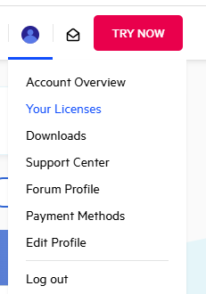
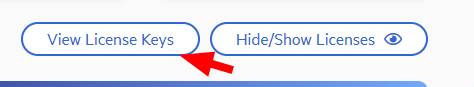
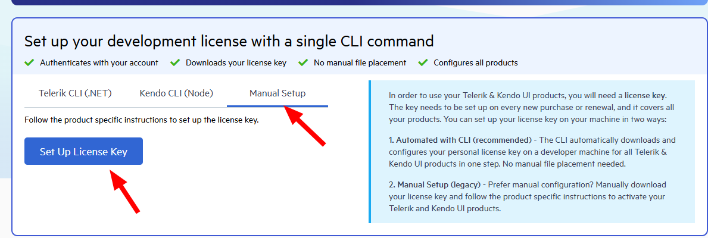
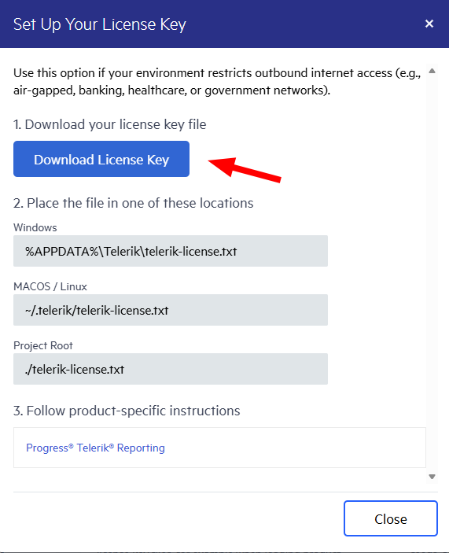
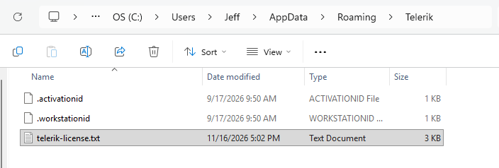
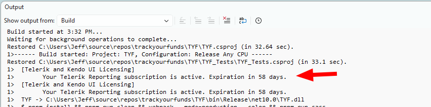

# Telerik license load into Visual Studio on your machine

- Log into Telerik with your Telerik licensed ID ([tyfadmin@trackyourfunds.com](mailto:tyfadmin@trackyourfunds.com)). Password stored securely in 1Password.
- Go to ‘Your Licenses’ under the profile logo

- On the Licenses Page, click on View License Keys

- Click on Manual Setup & then Set Up License Key

- Click on Download License Key

- On your workstation browse to ‘Users/username/AppData/Roaming/Telerik & copy the Telerik-license.txt file you just downloaded into that folder. If a folder does not exist under Roaming, create a folder called Telerik.

- In Visual Studio do a build TYF which forces a nuget restore and it should show it found a license.

